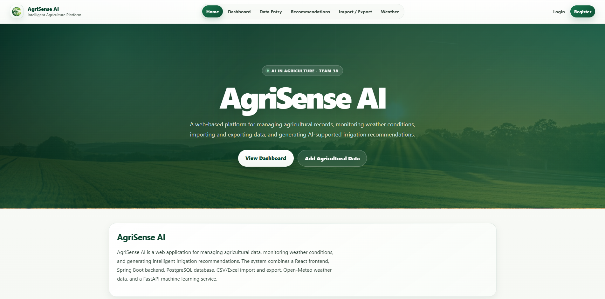
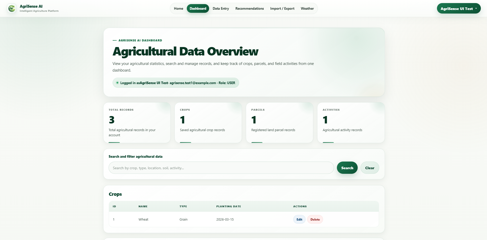
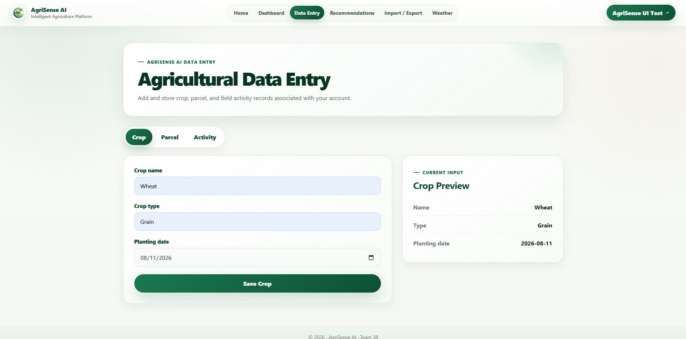
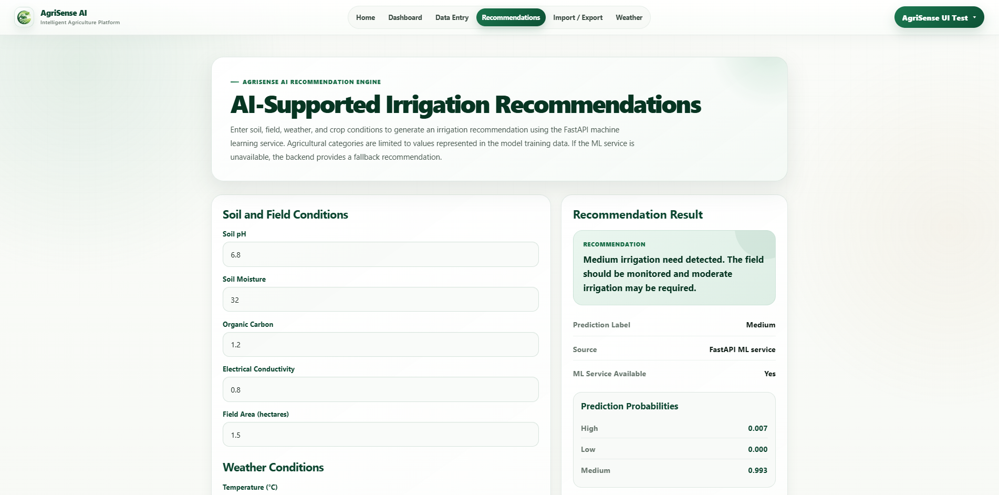
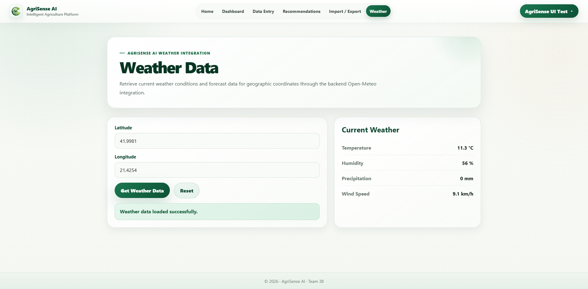
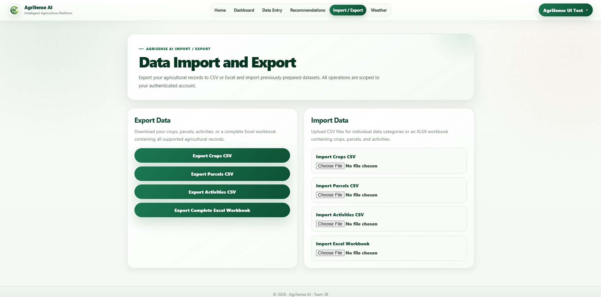
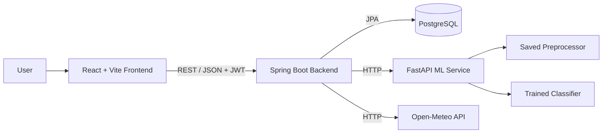

# AgriSense AI

[](https://github.com/nikolasarafimov/agrisense-ai/actions/workflows/ci.yml)

**AgriSense AI** is a full-stack academic prototype for agricultural data management and AI-assisted irrigation-need prediction.

The platform enables authenticated users to manage crops, parcels, and agricultural activities, view personalized dashboard statistics, import and export agricultural data, retrieve weather information, and generate machine-learning-supported irrigation recommendations.

The system combines a React frontend, Spring Boot REST API, PostgreSQL database, FastAPI machine learning service, and Docker Compose.

> Developed by Team 38 for the **ICT Project Management** course.

**Live application:** [https://agrisense-ai-six.vercel.app](https://agrisense-ai-six.vercel.app)

---

## Overview

AgriSense AI demonstrates how a modern web application can combine secure authentication, relational persistence, external weather data, data portability, and machine learning in a single agricultural decision-support platform.

The application provides:

- secure user registration and login
- JWT-based authentication and authorization
- user-owned agricultural records
- crop, parcel, and agricultural activity management
- personalized dashboard statistics
- search and filtering
- live weather integration through Open-Meteo
- CSV and Excel import/export
- machine-learning-assisted irrigation-need prediction
- role-based administration
- Dockerized multi-service deployment

---

## UI Preview

### Home



### Application Views

| Dashboard | Data Entry |
|---|---|
|  |  |

| AI Recommendations | Weather |
|---|---|
|  |  |

### Import / Export



---

## Main Features

### Authentication and Security

- User registration and login
- JWT-based authentication
- BCrypt password hashing
- Stateless Spring Security
- Protected backend endpoints
- User-owned agricultural records
- Role-based `ADMIN` authorization
- Protected frontend routes
- Configurable CORS policy
- Request validation
- Structured API error responses

### Agricultural Data Management

Authenticated users can create, view, search, edit, and delete:

- crops
- parcels
- agricultural activities

Each record belongs to the currently authenticated user.

The backend derives the user identity from the Spring Security context rather than accepting a normal `userId` request parameter.

### Dashboard

The dashboard provides personalized statistics including:

- crop count
- parcel count
- activity count
- total agricultural records

It also provides search and record-management functionality.

### Import and Export

Supported formats:

- CSV
- Microsoft Excel (`.xlsx`)

Supported data:

- crops
- parcels
- activities

Imported records are automatically associated with the authenticated user.

### Weather Integration

The Spring Boot backend integrates with the Open-Meteo API using geographic coordinates.

Weather data includes:

- temperature
- relative humidity
- precipitation
- wind speed
- daily temperature forecast
- daily precipitation forecast

The frontend communicates only with the Spring Boot backend. External weather requests are handled server-side.

### AI Recommendations

The backend communicates with a separate FastAPI machine learning service.

The ML service processes soil, crop, weather, irrigation, and field-related input and predicts one of three irrigation-need classes:

```text
Low
Medium
High
```

Prediction probabilities are returned when supported by the selected classifier.

### Administration

Users with the `ADMIN` role can manage:

- users
- crops
- parcels
- activities

Administrative authorization is enforced by Spring Security on the backend and reflected in frontend routing.

---

## System Architecture



| Component | Technology | Purpose |
|---|---|---|
| Frontend | React + Vite | User interface |
| Backend | Spring Boot | REST API, security, validation and business logic |
| Database | PostgreSQL | Persistent application data |
| ML Service | FastAPI | Irrigation-need prediction |

Docker Compose runs the complete platform as a multi-container application.

---

## Technology Stack

### Frontend

- React
- Vite
- React Router
- JavaScript
- CSS
- Nginx

### Backend

- Java 21
- Spring Boot
- Spring Web
- Spring Data JPA
- Spring Security
- Bean Validation
- JJWT
- PostgreSQL Driver
- Apache POI
- OpenCSV
- Springdoc OpenAPI
- Gradle

### Database

- PostgreSQL
- H2 for backend tests

### Machine Learning

- Python 3.11
- FastAPI
- Uvicorn
- pandas
- NumPy
- scikit-learn
- XGBoost
- LightGBM
- joblib

### DevOps and Tooling

- Git
- GitHub
- Docker
- Docker Compose
- Gradle
- npm
- Jira

---

## Project Structure

```text
agrisense-ai/
├── backend/
│   ├── src/
│   │   ├── main/
│   │   └── test/
│   ├── gradle/
│   ├── Dockerfile
│   └── build.gradle
│
├── frontend/
│   ├── public/
│   ├── src/
│   ├── Dockerfile
│   ├── nginx.conf
│   ├── package.json
│   └── vite.config.js
│
├── ml/
│   ├── app/
│   │   ├── __init__.py
│   │   ├── feature_engineering.py
│   │   ├── main.py
│   │   ├── model_loader.py
│   │   ├── schemas.py
│   │   └── utils.py
│   ├── data/
│   │   └── irrigation_prediction.csv
│   ├── notebooks/
│   │   └── model_selection.ipynb
│   ├── trained_model_objects/
│   │   ├── healthy_soil_moisture_threshold.pkl
│   │   ├── irrigation_model.pkl
│   │   ├── label_encoder.pkl
│   │   └── preprocessor.pkl
│   ├── Dockerfile
│   ├── README.md
│   └── requirements.txt
│
├── docs/
│   ├── research/
│   │   └── weather-api-research.md
│   ├── database.sql
│   └── import-export-specification.md
│
├── .env.example
├── .gitignore
├── docker-compose.yml
└── README.md
```

---

## Security Model

AgriSense AI uses stateless JWT authentication.

After successful registration or login, the backend returns a JWT token.

Protected frontend requests include:

```http
Authorization: Bearer <token>
```

Spring Security validates the token before protected resources are accessed.

### Public Endpoints

```http
POST /api/users/register
POST /api/users/login

GET  /api/weather
GET  /api/health
```

Swagger/OpenAPI resources are also publicly accessible.

### Authenticated Endpoints

Agricultural data, dashboard statistics, profile management, recommendations, and import/export functionality require authentication.

### Administrator Endpoints

```text
/api/admin/**
```

requires the `ADMIN` role.

### Data Ownership

Crop, parcel, and agricultural activity operations are scoped to the authenticated user.

For example:

```http
GET /api/crops
```

returns crops belonging only to the current user.

---

## REST API Overview

### Authentication and Profile

```http
POST /api/users/register
POST /api/users/login

GET  /api/users/me
PUT  /api/users/me
```

Logout is handled by the frontend by removing locally stored authentication state.

### Crops

```http
GET    /api/crops
GET    /api/crops?search=tomato
GET    /api/crops/{id}

POST   /api/crops
PUT    /api/crops/{id}
DELETE /api/crops/{id}
```

Example:

```json
{
  "name": "Tomato",
  "type": "Vegetable",
  "plantingDate": "2026-05-15"
}
```

### Parcels

```http
GET    /api/parcels
GET    /api/parcels?search=loamy
GET    /api/parcels/{id}

POST   /api/parcels
PUT    /api/parcels/{id}
DELETE /api/parcels/{id}
```

Example:

```json
{
  "location": "Skopje",
  "size": 1200,
  "soilType": "Loamy"
}
```

### Activities

```http
GET    /api/activities
GET    /api/activities?search=irrigation
GET    /api/activities/{id}

POST   /api/activities
PUT    /api/activities/{id}
DELETE /api/activities/{id}
```

Example:

```json
{
  "description": "Morning irrigation",
  "date": "2026-05-15",
  "type": "Irrigation"
}
```

Dates use ISO format:

```text
yyyy-MM-dd
```

### Dashboard

```http
GET /api/dashboard/stats
```

Example response:

```json
{
  "cropsCount": 5,
  "parcelsCount": 3,
  "activitiesCount": 8,
  "totalRecords": 16
}
```

### Weather

```http
GET /api/weather?latitude=41.9981&longitude=21.4254
```

The backend validates the coordinates and retrieves weather information from Open-Meteo.

### Recommendations

```http
POST /api/recommendations
```

The backend validates the request and forwards prediction data to the FastAPI ML service.

### Import and Export

```http
GET  /api/data/export/crops
POST /api/data/import/crops

GET  /api/data/export/parcels
POST /api/data/import/parcels

GET  /api/data/export/activities
POST /api/data/import/activities

GET  /api/data/export/excel
POST /api/data/import/excel
```

Import endpoints use multipart form data with the field name:

```text
file
```

Detailed format and validation rules are documented in:

```text
docs/import-export-specification.md
```

### Administration

```http
GET    /api/admin/users
GET    /api/admin/crops
GET    /api/admin/parcels
GET    /api/admin/activities

DELETE /api/admin/users/{id}
DELETE /api/admin/crops/{id}
DELETE /api/admin/parcels/{id}
DELETE /api/admin/activities/{id}
```

These endpoints require the `ADMIN` role.

---

## API Error Handling

The backend provides structured error responses for validation failures, authentication errors, authorization failures, missing resources, conflicts, malformed requests, and internal errors.

Typical HTTP status codes include:

```text
400 Bad Request
401 Unauthorized
403 Forbidden
404 Not Found
409 Conflict
500 Internal Server Error
```

---

## Machine Learning Service

The machine learning component runs as an independent FastAPI service.

Endpoints:

```http
GET  /health
POST /predict
```

Local URL:

```text
http://localhost:8000
```

FastAPI documentation:

```text
http://localhost:8000/docs
```

The Spring Boot backend communicates with the service through:

```text
ML_SERVICE_URL
```

In Docker Compose:

```text
http://ml-service:8000
```

---

## ML Model

The training workflow evaluates multiple classification algorithms, including:

- Logistic Regression
- Random Forest
- XGBoost
- LightGBM

Model comparison and hyperparameter tuning are performed using cross-validation.

The best-performing model is selected by the training workflow and serialized for use by the FastAPI inference service.

The complete workflow is documented in:

```text
ml/notebooks/model_selection.ipynb
```

The training dataset is stored in:

```text
ml/data/irrigation_prediction.csv
```

Runtime artifacts are stored in:

```text
ml/trained_model_objects/
```

### Feature Engineering

The prediction API receives 19 raw features.

Before inference, four engineered features are generated:

```text
Moisture_Deficit
Water_Availability
ET_Proxy
Irrigation_per_Hectare
```

The final preprocessor input therefore contains 23 features.

Detailed ML-service documentation is available in:

```text
ml/README.md
```

---

# Getting Started

## Prerequisites

For Docker-based startup:

- Docker
- Docker Compose

For manual development:

- Java 21
- Node.js
- npm
- Python 3.11
- PostgreSQL

---

## Environment Configuration

Copy the public environment template.

### Windows PowerShell

```powershell
Copy-Item .env.example .env
```

### Linux / macOS

```bash
cp .env.example .env
```

Example configuration:

```env
POSTGRES_DB=agriculture_db
POSTGRES_USER=postgres
POSTGRES_PASSWORD=change_me

SPRING_JPA_HIBERNATE_DDL_AUTO=update
ML_SERVICE_URL=http://ml-service:8000

VITE_API_BASE_URL=http://localhost:8080

JWT_SECRET=REPLACE_WITH_32_BYTE_BASE64_SECRET
JWT_EXPIRATION_MS=86400000

CORS_ALLOWED_ORIGINS=http://localhost:5173
```

Before startup, replace:

```text
POSTGRES_PASSWORD
JWT_SECRET
```

with secure local values.

The `.env` file is ignored by Git and must not be committed.

---

## Generate a JWT Secret

Generate a sufficiently long Base64-encoded secret.

Using OpenSSL:

```bash
openssl rand -base64 32
```

Add it to:

```env
JWT_SECRET=<generated-value>
```

The real secret should remain only in local or deployment secret storage.

---

# Running with Docker Compose

From the repository root:

```bash
docker compose up --build
```

This starts:

```text
PostgreSQL
Spring Boot backend
FastAPI ML service
React/Nginx frontend
```

The current Compose configuration exposes the services as follows:

| Service | URL |
|---|---|
| Frontend | http://localhost:5173 |
| Backend | http://localhost:8080 |
| Backend Health | http://localhost:8080/api/health |
| Swagger UI | http://localhost:8080/swagger-ui.html |
| ML Service | http://localhost:8000 |
| ML Health | http://localhost:8000/health |
| ML Documentation | http://localhost:8000/docs |

Stop the application:

```bash
docker compose down
```

Remove containers and the PostgreSQL volume:

```bash
docker compose down -v
```

> `docker compose down -v` permanently removes the local Docker database volume and should only be used when a clean database reset is intended.

---

# Manual Development

## Backend

### Windows

```powershell
cd backend
.\gradlew.bat bootRun
```

### Linux / macOS

```bash
cd backend
./gradlew bootRun
```

Backend:

```text
http://localhost:8080
```

Swagger UI:

```text
http://localhost:8080/swagger-ui.html
```

---

## Frontend

```bash
cd frontend
npm ci
npm run dev
```

Frontend:

```text
http://localhost:5173
```

---

## Machine Learning Service

### Windows PowerShell

```powershell
cd ml
python -m venv .venv
.venv\Scripts\Activate.ps1
pip install -r requirements.txt
uvicorn app.main:app --reload --port 8000
```

### Linux / macOS

```bash
cd ml
python -m venv .venv
source .venv/bin/activate
pip install -r requirements.txt
uvicorn app.main:app --reload --port 8000
```

ML service:

```text
http://localhost:8000
```

---

# Testing and Validation

## Backend

### Windows

```powershell
cd backend
.\gradlew.bat clean test
```

### Linux / macOS

```bash
cd backend
./gradlew clean test
```

## Frontend

```bash
cd frontend
npm ci
npm run lint
npm run build
```

## Docker Compose

Validate the Compose file:

```bash
docker compose config --quiet
```

Build all images:

```bash
docker compose build
```

Start the complete platform:

```bash
docker compose up -d
```

Check container status:

```bash
docker compose ps
```

---

# Frontend Pages

The React application contains:

```text
Home
Login
Register
Dashboard
Data Entry
Profile
Recommendations
Import / Export
Weather
Admin
```

Protected routes prevent unauthenticated users from accessing secured pages.

The Admin page additionally requires the `ADMIN` role.

---

# Documentation

Additional project documentation is available under `docs/`.

### Database Schema

```text
docs/database.sql
```

Contains the relational database schema for users, crops, parcels, and activities.

### Import/Export Specification

```text
docs/import-export-specification.md
```

Documents CSV and Excel formats, validation, security, ownership, and import/export behavior.

### Weather API Research

```text
docs/research/weather-api-research.md
```

Documents the Open-Meteo provider selection and backend integration.

### ML Service

```text
ml/README.md
```

Documents the FastAPI inference service, model artifacts, feature engineering, and local execution.

---

# Demonstration Flow

A recommended demonstration sequence is:

1. Register a new account.
2. Log in.
3. Add a crop, parcel, and agricultural activity.
4. View personalized dashboard statistics.
5. Search, edit, and delete agricultural records.
6. View weather information.
7. Generate an AI-assisted irrigation recommendation.
8. Export data as CSV or Excel.
9. Import agricultural data.
10. Update the user profile.
11. Optionally demonstrate `ADMIN` functionality.

For a shorter presentation:

```text
Authentication
Dashboard
Data Entry
Weather
AI Recommendations
Import / Export
```

---

# Current Status

AgriSense AI is a working academic prototype integrating:

```text
React frontend
Spring Boot REST API
PostgreSQL persistence
FastAPI ML service
JWT authentication
Spring Security authorization
User-owned agricultural data
ADMIN role enforcement
Crop management
Parcel management
Activity management
Profile management
Personalized dashboard statistics
Search and filtering
Open-Meteo weather integration
AI-assisted irrigation-need prediction
CSV import/export
Excel import/export
Request validation
Structured API error handling
Backend automated tests
Docker Compose deployment
```

---

# Future Improvements

Potential future development includes:

- refresh-token authentication
- email verification
- password-reset workflow
- Flyway or Liquibase database migrations
- production secret management
- expanded integration and end-to-end tests
- CI/CD
- cloud deployment
- advanced dashboard analytics
- expanded machine learning evaluation
- additional agricultural recommendation models
- deeper weather-to-ML integration
- centralized logging and monitoring
- accessibility improvements

---

# Team

**Team 38 — ICT Project Management**

1. Nikola Sarafimov
2. Sofija Andonova
3. Atanas Vitanov
4. Marko Trajkovski
5. Kire Boškovski
6. Ivan Perchuklieski
7. Mila Todorovska
8. Barbara Popovska
9. Nikola Popov
10. Zagorka Anevska

---

## Project Theme

**Artificial Intelligence in Agriculture**

**Selected topic:**

Intelligent System for Analysis and Recommendations in Agriculture

---

## Status

```text
Project: AgriSense AI
Type: Full-stack academic prototype
Course: ICT Project Management
Team: 38
Status: Working prototype
```